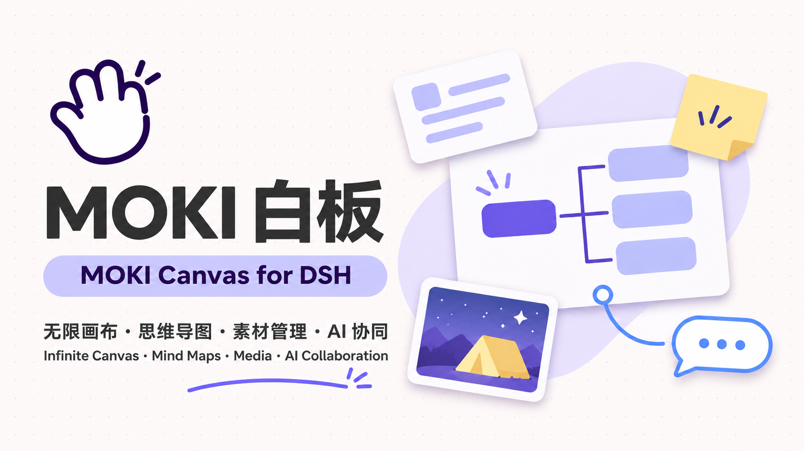
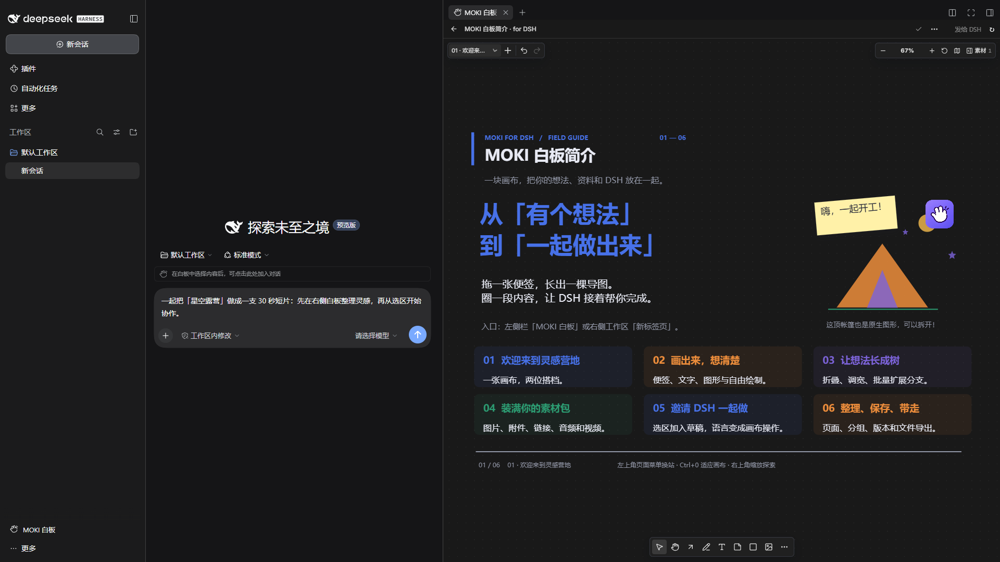
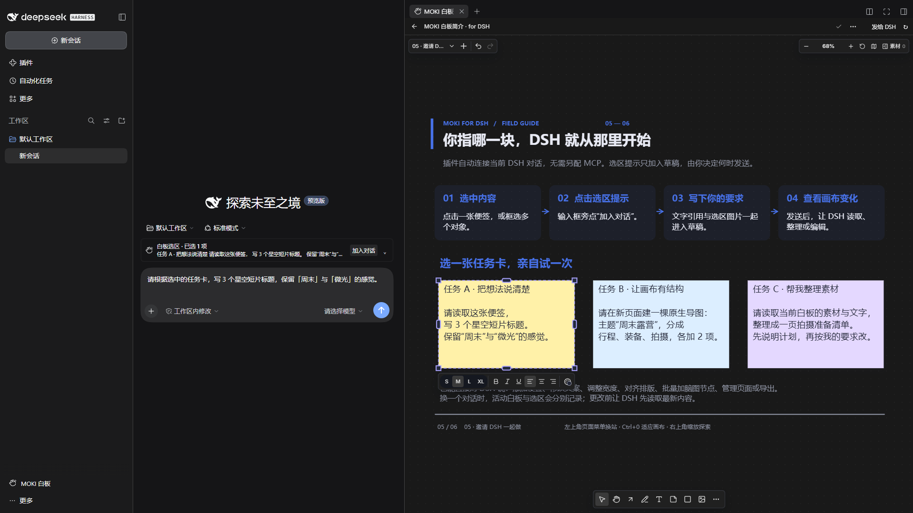
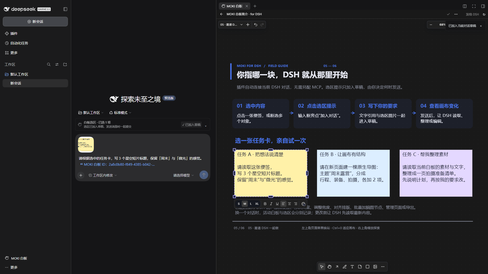
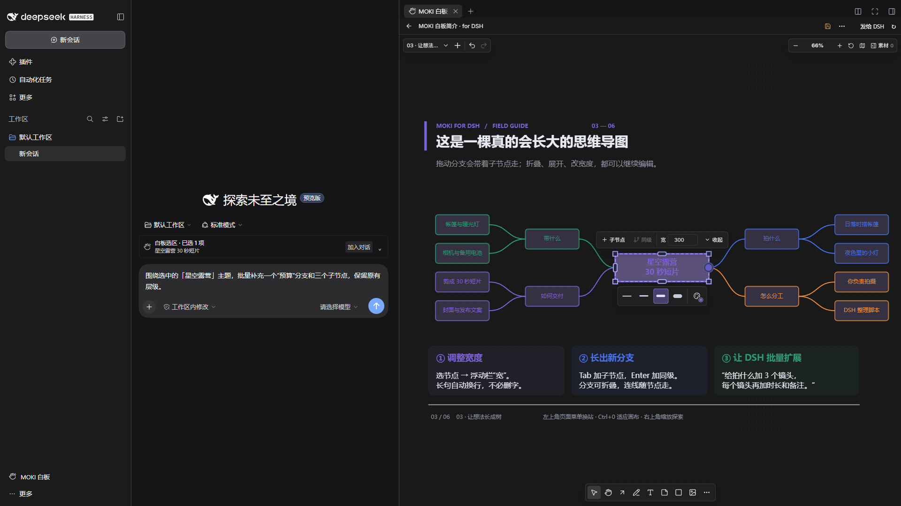
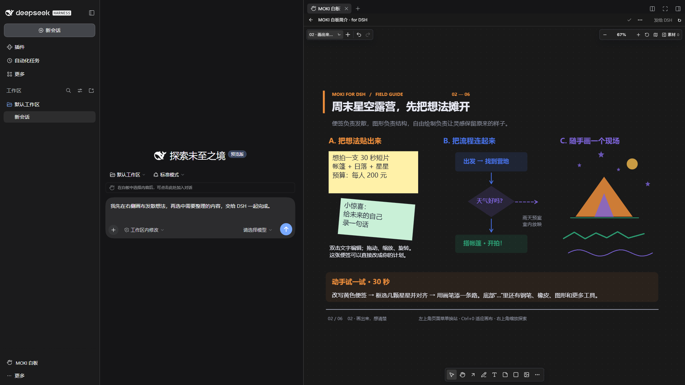
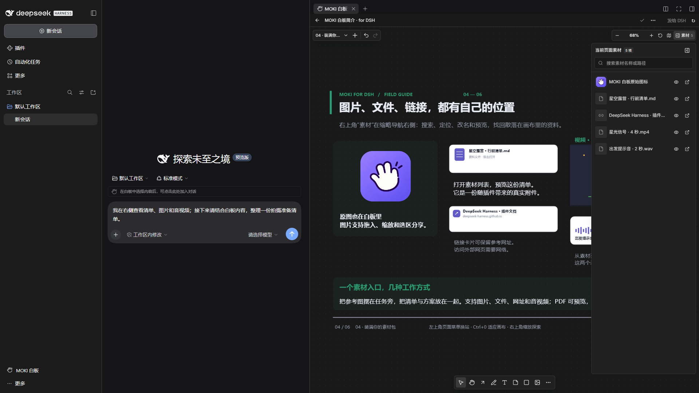
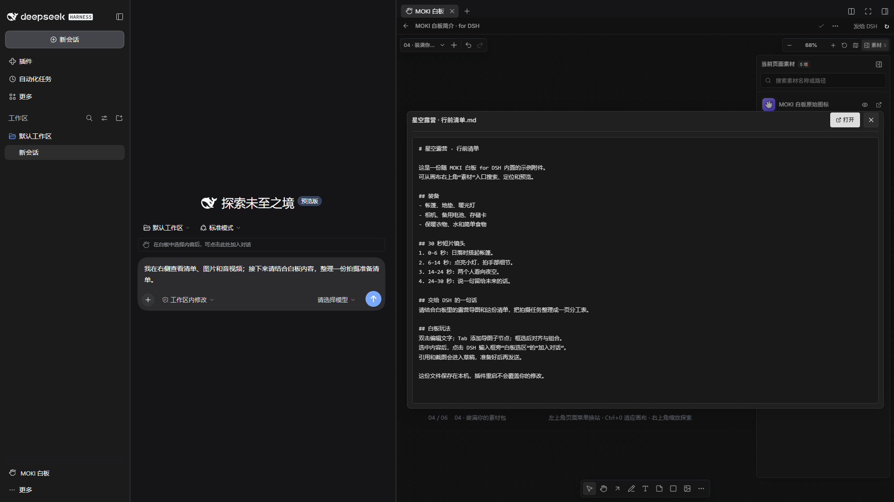
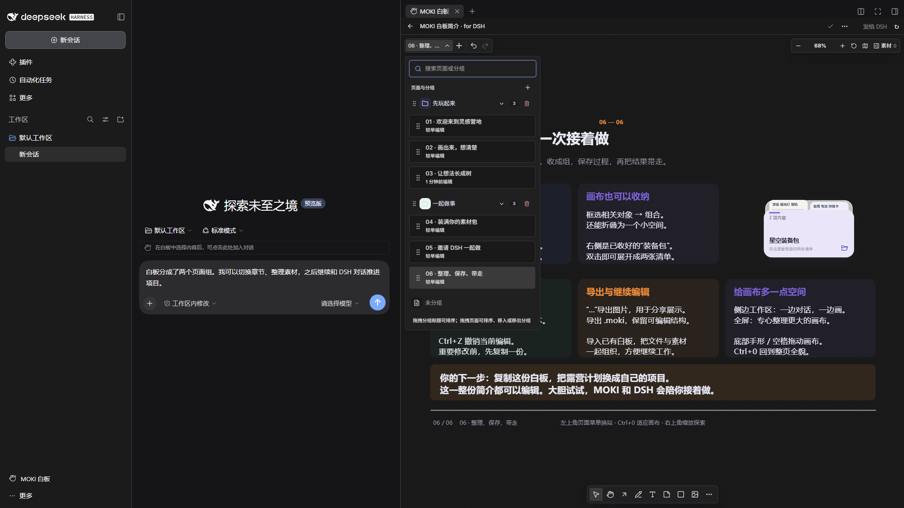

# MOKI Canvas for DSH

[简体中文](README.zh-CN.md) · [Install with DSH](#install-by-chat) · [Import formats](#supported-imports) · [Download](https://github.com/JKZeng-cell/moki-canvas-for-dsh/releases/latest) · [DSH plugin community](https://github.com/topics/dsh-plugin)



**A local-first canvas for thinking, creating, and working with DeepSeek Harness.**

MOKI Canvas brings an editable infinite canvas into DSH's side workspace. Sketch an idea, grow it into a mind map, collect references, and keep notes, images, files, audio, and video together. The compact interface follows DSH's light or dark theme and leaves more room for your work.

Work with DSH in both directions: let the agent read and edit your boards, or select something on the canvas and click **Add to chat** beside the composer. Your selection becomes a text reference and an image attachment in the current draft. You decide when to send it. A six-page, fully editable introduction board lets you explore the tools through a playful camping-film project.

## See it in action

These are real, dark-theme DSH interface captures from a separate demo profile containing only the bundled introduction. The sidebar entry, conversation composer and side workspace stay visible, so you can see how the plugin works inside DSH. No personal boards, accounts, chat history, or local paths are included. The visible prompts are unsent demonstration drafts.

**1. Open a canvas beside your conversation.**



**2. Select content on the right. A selection hint appears beside the DSH composer.**



**3. Click Add to chat. The text reference and screenshot join your draft; your typed request is preserved.**



**4. Edit the canvas directly, or prepare a request for DSH. Here, a mind-map node is selected and its width is adjusted.**



<details>
<summary>More interactions inside DSH: drawing, materials, previews and page navigation</summary>









</details>

## What you can do

- **Draw and arrange:** sticky notes, text, shapes, arrows, freehand strokes, Bézier paths, alignment, grouping, zoom, and a minimap.
- **Build real mind maps:** edit node text and width, drag branches, collapse or expand them, and add nodes with Tab or Enter. DSH can add up to 200 nodes in one batch while preserving hierarchy.
- **Keep references nearby:** add images, files, links, audio, and video; search, locate, rename, and preview items from the page's materials list.
- **Organize a project:** multiple pages and page groups, editable boards, version history, `.moki` import/export, and image export.
- **Collaborate with DSH:** canvas tools register automatically. Ask the agent to inspect, create, update, arrange, or export content without setting up a separate MCP server.
- **Share a selection deliberately:** a composer hint previews the active selection; clicking adds its text and screenshot to the draft, preserving what you have typed. It does not send a message automatically.
- **Learn by editing:** the bundled introduction contains six pages, native mind-map nodes, an expandable materials group, and small offline media examples.

## Supported imports

Drop files onto the canvas, paste images or URLs, or add materials from the toolbar. The following describes importing and previewing in **DSH plugin v1.5.3**:

| Type | Formats | Behavior in the canvas |
| --- | --- | --- |
| Images | PNG, JPG / JPEG, WebP, GIF, AVIF, BMP, SVG | Place, move, resize, and view images on the canvas |
| Video | MP4, WebM, M4V, MOV, OGV, MKV, AVI | Recognized as video cards; playback depends on DSH's embedded browser and the file's codecs |
| Audio | MP3, WAV, M4A, AAC, OGG, OGA, Opus, FLAC | Drop as audio cards; playback also depends on browser codec support |
| PDF | `.pdf` | Stored as file cards, with paginated previews in the materials dialog |
| Text and code | `.txt`, `.md`, `.markdown`, `.json`, `.csv`, `.tsv`, `.log`, `.yaml`, `.yml`, `.xml`, `.css`, `.js`, `.ts`, `.py` | Plain-text preview in the materials dialog, up to 5 MB |
| Office and other attachments | DOC / DOCX, XLS / XLSX, PPT / PPTX, ZIP, RAR, 7Z, and other files | Stored as file cards; use Open to access the original file. These formats currently have no inline preview in the DSH materials dialog |
| Web and image links | HTTP / HTTPS URLs and direct image URLs | Paste as link cards or images; embedded web previews depend on the destination site's embedding policy |
| MOKI board files | `.moki`, `.moki-board`, `.moki.json`, `.moki-board.json` | Use Open board file or drag and drop to import editable board content |

Markdown, JSON, CSV, and TSV files are shown as source text in the current DSH materials dialog. Ordinary `.json` files are text attachments; MOKI board documents use the dedicated board importer.

## Install

Tested with **DeepSeek Harness 0.2.2-rc.1 on Windows x64**. Other operating systems and DSH versions have not been verified for this release. The canvas UI and built-in tour are primarily Chinese; the plugin's DSH entry and selection controls also provide English labels.

### Install by chat

Open a DSH conversation with plugin management available. Copy the entire prompt below into the composer and send it:

```text
Please install and enable MOKI Canvas for DSH v1.5.3.

Project: https://github.com/JKZeng-cell/moki-canvas-for-dsh
Read the project's installation instructions, then use plugin_manager in the current DSH environment:
First call list_bundles. If this version is installed, confirm it is enabled or enable it with set_bundle; do not reinstall it.
If it is not installed, call install_bundle with enabled=true and this prebuilt package as the target:
https://github.com/JKZeng-cell/moki-canvas-for-dsh/releases/download/v1.5.3/dsh-moki-canvas-1.5.3.tgz

After installation, check the version and enabled state of dsh-moki-canvas and explain how to open it from the sidebar or side workspace.
If the result is restart-required, tell me to restart DSH. Preserve existing boards, attachments, and other plugins.
```

This uses the plugin manager in your current DSH environment. If the tool is unavailable, use a preset with plugin management enabled, such as Creator, or enter the same package URL on the sidebar's Plugins page. Check the reported version, enabled state, and any restart instruction. See the [DSH plugin-manager reference](https://github.com/deepseek-ai/deepseek-harness/blob/master/packages/boot/plugin-manager/README.md).

### Manual installation

1. Download `dsh-moki-canvas-1.5.3.tgz` from [Releases](https://github.com/JKZeng-cell/moki-canvas-for-dsh/releases/tag/v1.5.3).
2. For Desktop, use **Manage dsh Command…** in the application menu to install or repair the bundled command. Open a new terminal and run `dsh --version` to confirm it matches Desktop. Then fully quit DSH from its application or tray menu; closing the window may leave it running.
3. In the directory containing the downloaded package, run:

   ```sh
   dsh plugin --profile desktop add ./dsh-moki-canvas-1.5.3.tgz
   dsh plugin --profile desktop list dsh-moki-canvas --depth 0
   ```

4. Reopen DSH. Select **MOKI Canvas** below **Automation tasks** in the left sidebar to open the canvas beside your chat. You can also choose **MOKI Canvas** from a new tab in the right workspace.

Manage the `desktop` profile with Desktop's bundled CLI; a separately npm-installed `dsh` cannot manage that profile. For Web or a custom profile, replace `desktop` with its actual name and use the same `DSH_HOME` as your running DSH. See the [Desktop command reference](https://github.com/deepseek-ai/deepseek-harness/blob/master/apps/desktop/README.md#bundled-command-runtime).

The release contains the built application and host bundle. You do not need the MOKI source repository or a separate MOKI desktop app. DSH downloads the declared runtime dependencies during installation. See the [official packaging and installation guide](https://deepseek-harness.github.io/deepseek-harness/develop/basic/publish).

If you previously installed the development package `@local/dsh-moki-whiteboard`, remove that plugin before adding `dsh-moki-canvas`, so that only one copy runs. Both use the same default board-data directory; removing the plugin package does not delete that directory.

## Try it

Open **MOKI 白板简介 · for DSH**, choose a page from the upper-left menu, and press **Ctrl+0** to fit the page. Duplicate the guide before experimenting if you want to keep a reference copy.

On page 5, select a task card and click **Add to chat / 加入对话**. Then ask, for example:

> Read the selected notes and turn them into a three-step shooting plan. Update only the selected content.

> Create a two-sided mind map for a weekend camping film. Use wider nodes for long text, and add the preparation tasks in one batch.

The introduction is initialized once per data directory. Your edits survive restarts, and deleting it does not cause it to reappear.

## Data and collaboration

Boards and attachments live in `$DSH_HOME/whiteboard`, or `~/.dsh/whiteboard` when `DSH_HOME` is unset. The embedded service listens on `127.0.0.1` at an automatically assigned port. LAN sharing starts disabled for a new data directory; existing preferences are preserved.

Active canvas context and selection are scoped to the current DSH chat. Tools with an explicit board ID can also access other boards in the same local library. Edits support version checks to prevent stale writes. Content added to a chat is sent through your configured DSH model/provider when you submit the message.

This is a community plugin built on [MOKI 白板](https://github.com/JKZeng-cell/moki-whiteboard). It is not an official DeepSeek product.

## Develop

The repository includes the exact canvas source snapshot in `vendor/moki`, the plugin source, and prebuilt runtime files. Use Node.js 22.13 or later.

```sh
npm ci
npm ci --prefix vendor/moki --ignore-scripts
npm run typecheck
npm run build
npm test
npm run test:canvas
npm pack
```

`src/host.js` starts the embedded canvas server and adapts its tools to DSH. `client.js` provides workspace tabs, sidebar access, theme synchronization, and selection-to-draft controls. `src/builtin-intro.js` initializes the editable guide without replacing user edits. `scripts/build.mjs` builds against `vendor/moki` by default; `MOKI_REPO` can point to another compatible checkout.

See [release validation](docs/release-validation.md), [bilingual project copy](docs/project-introduction.md), and the [3:4 portrait cover](docs/images/cover-portrait-3x4.png).

## License

[MIT](LICENSE). Third-party software and fonts retain their own licenses; see [THIRD_PARTY_NOTICES.md](THIRD_PARTY_NOTICES.md).
