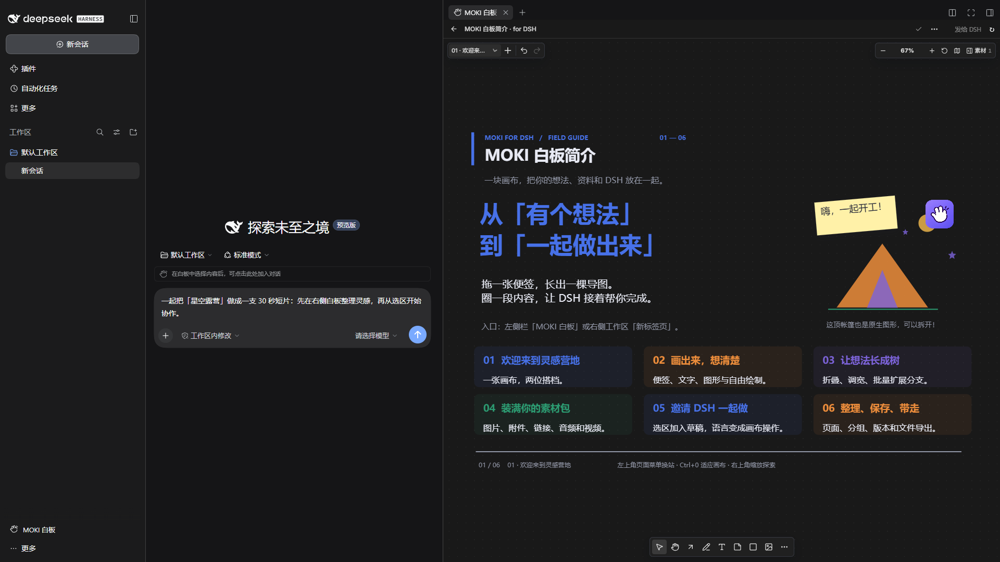
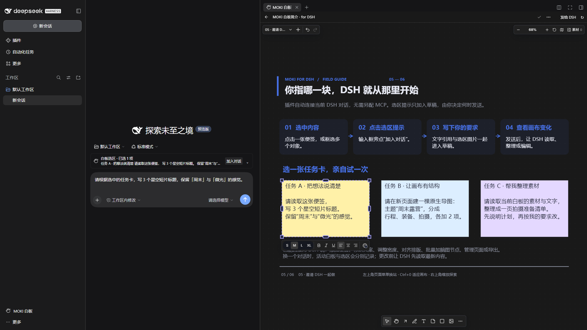
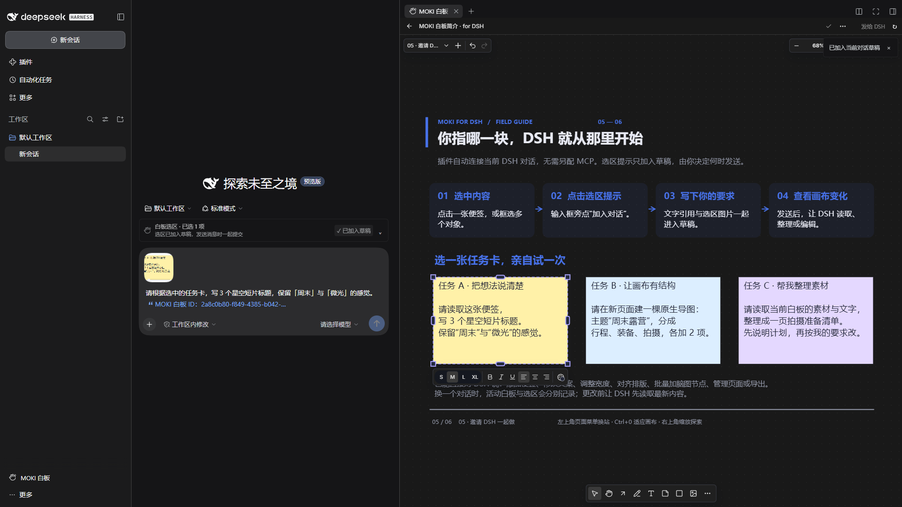
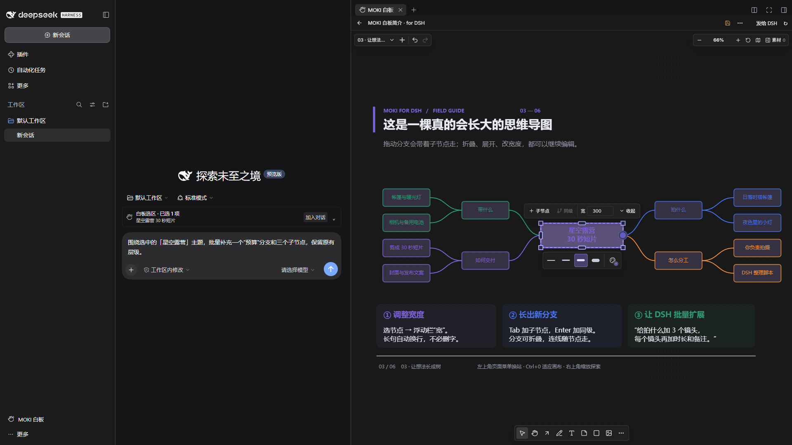
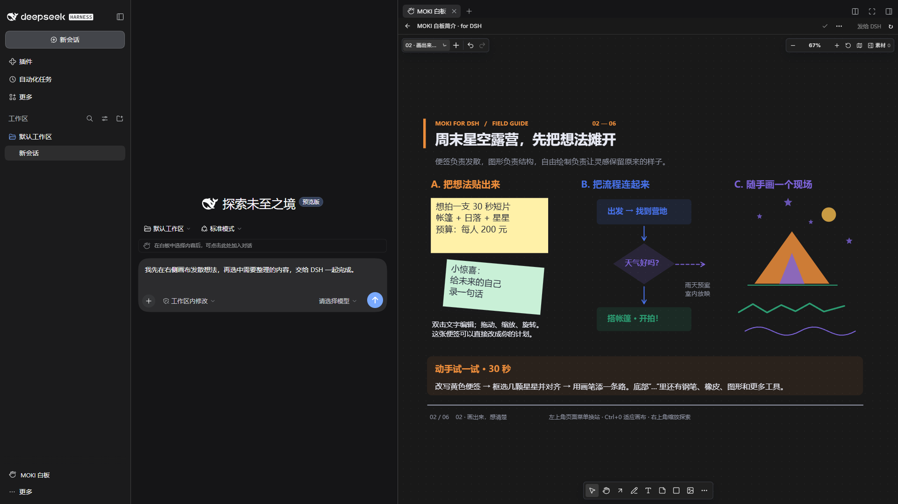
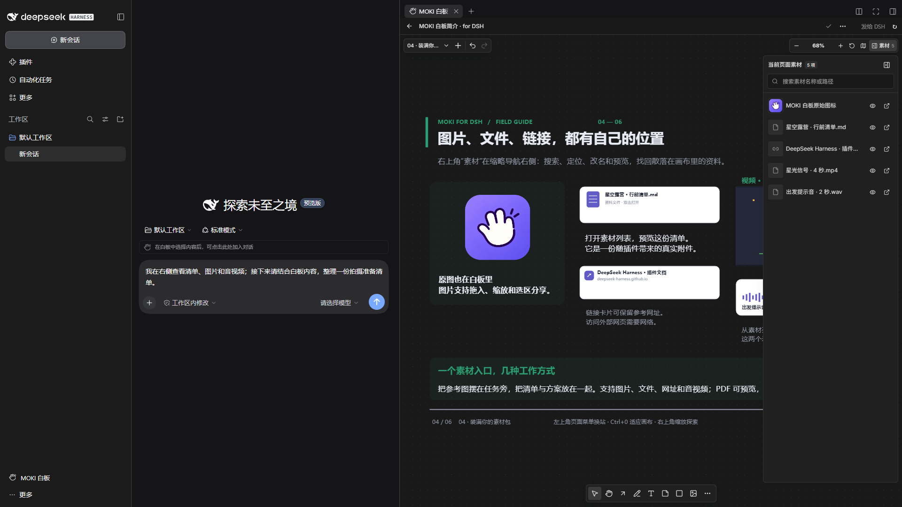
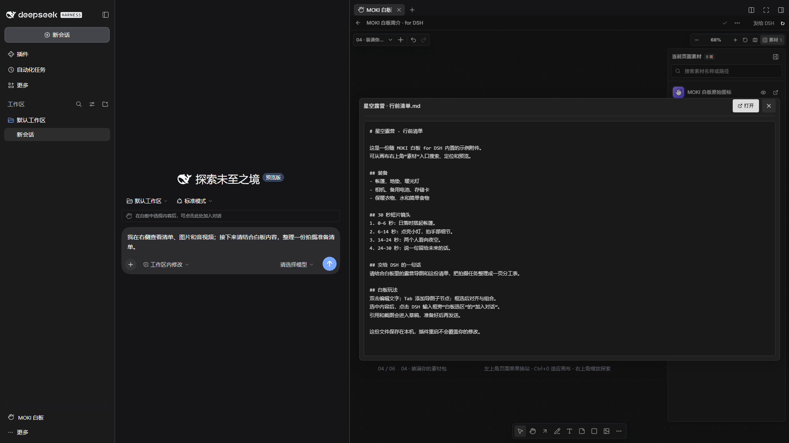
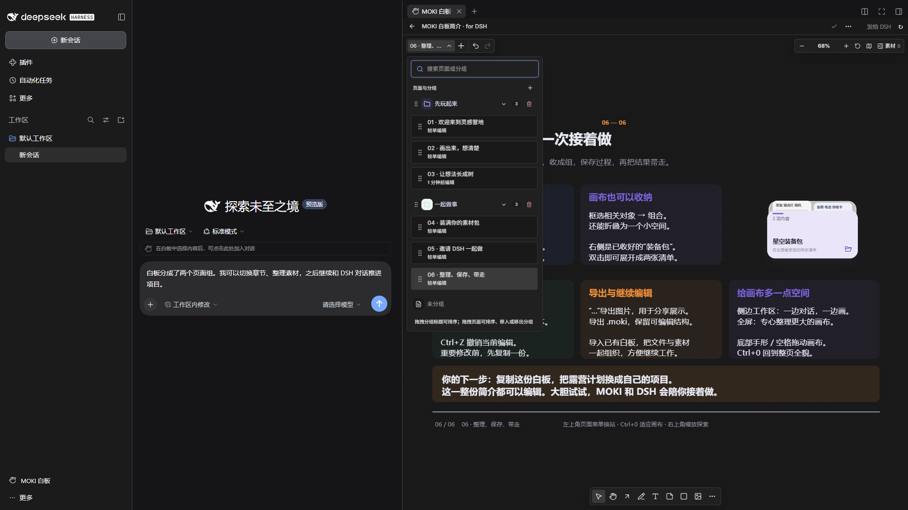

# MOKI 白板 for DSH

[English](README.md) · [发送给 DSH 安装](#通过对话安装) · [置入格式](#支持置入的格式) · [下载插件](https://github.com/JKZeng-cell/moki-canvas-for-dsh/releases/latest) · [DSH 插件社区](https://github.com/topics/dsh-plugin)


**一张和 DSH 一起思考、整理与创作的本地画布。**

MOKI 白板 for DSH（英文名 **MOKI Canvas for DSH**）将可编辑的无限画布带进 DeepSeek Harness 侧边工作区。你可以随手画下想法，将它展开成思维导图，把便签、图片、文件、链接、音视频放在同一处，逐步整理成完整项目。紧凑界面跟随 DSH 的深浅色主题，让画布保留更多空间。

白板与对话可以双向协作：让 DSH 读取、创建和修改画布，或选中画布内容，点击输入框旁的“加入对话”，将文字引用和选区截图放进当前草稿，再由你决定何时发送。插件内置六页可编辑的“星空露营短片”简介，用真实的白板工具带你边玩边学。

## 界面预览

以下均为独立演示环境中的 DSH 暗调主界面实拍。左侧白板入口、对话输入框和右侧工作区同时保留，展示插件在 DSH 中的状态与交互方式。只使用内置示例，不包含个人白板、账号、聊天记录和本机路径；输入框中的文字是未发送的演示草稿。

**1. 从左侧入口打开白板，与对话并排工作。**



**2. 在右侧选中内容，DSH 输入框旁出现选区提示。**



**3. 点击“加入对话”，文字引用和截图进入草稿，已经输入的要求继续保留。**



**4. 直接编辑白板，也可以准备一条 DSH 请求。这里选中了脑图节点，并调整了节点宽度。**



<details>
<summary>更多 DSH 内交互：绘图、素材列表、附件预览与页面分组</summary>









</details>

## 主要能力

- **画出想法：**便签、文字、图形、箭头、自由绘图、贝塞尔曲线、对齐、分组、缩放和缩略导航。
- **让想法长成树：**原生思维导图支持节点宽度、文字换行、分支拖动、折叠展开，以及 Tab / Enter 添加节点；DSH 可一次批量添加最多 200 个节点并保留层级。
- **把素材放在手边：**加入图片、文件、链接、音视频，通过当前页面素材列表搜索、定位、重命名和预览。
- **整理整个项目：**多页面与页面分组、版本历史、`.moki` 导入导出、图片导出，让内容持续可编辑。
- **让 DSH 参与：**工具和活动白板上下文自动接入，可通过对话读取、创建、修改、排版和导出，无需单独配置 MCP。
- **选中后加入对话：**点击输入框旁的选区提示，将文字与截图加入草稿，保留已输入内容；不会自动发送消息。
- **在介绍里直接试：**六页内置简介包含可编辑对象、真实脑图节点、可展开的素材分组，以及可离线使用的小型图片、音频和视频示例。

## 支持置入的格式

可以拖入文件、粘贴图片或网址，也可以通过工具栏添加素材。以下是 **DSH 插件 v1.5.2** 的置入与预览方式：

| 类型 | 格式 | 在白板中的使用方式 |
| --- | --- | --- |
| 图片 | PNG、JPG / JPEG、WebP、GIF、AVIF、BMP、SVG | 作为图片置入画布，可移动、缩放和查看 |
| 视频 | MP4、WebM、M4V、MOV、OGV、MKV、AVI | 识别为视频卡片；播放能力取决于 DSH 内置浏览器和文件编码 |
| 音频 | MP3、WAV、M4A、AAC、OGG、OGA、Opus、FLAC | 拖入后作为音频卡片播放；同样受浏览器解码能力限制 |
| PDF | `.pdf` | 作为文件卡片保存，在素材窗口分页预览 |
| 文本与代码 | `.txt`、`.md`、`.markdown`、`.json`、`.csv`、`.tsv`、`.log`、`.yaml`、`.yml`、`.xml`、`.css`、`.js`、`.ts`、`.py` | 在素材窗口按文本预览；文本预览上限为 5 MB |
| Office 与其他附件 | DOC / DOCX、XLS / XLSX、PPT / PPTX、ZIP、RAR、7Z 等文件 | 以文件卡片置入和保存，通过“打开”访问原文件；当前 DSH 素材窗口不提供这些格式的内嵌预览 |
| 网页与图片链接 | HTTP / HTTPS 网址、图片直链 | 粘贴生成链接卡片或置入图片；网页预览取决于目标网站是否允许嵌入 |
| MOKI 白板文件 | `.moki`、`.moki-board`、`.moki.json`、`.moki-board.json` | 通过“打开白板文件”或拖入导入，恢复可继续编辑的白板内容 |

Markdown、JSON、CSV 和 TSV 文件在当前 DSH 素材窗口中按原文展示。普通 `.json` 属于文本附件；带 MOKI 格式的白板文件使用专用导入流程。

## 安装

本版实测环境为 **DeepSeek Harness 0.2.2-rc.1 / Windows x64**。其他系统和 DSH 版本尚未验证。画布和内置导览目前以中文为主；插件入口与选区协同控件提供中英文文案。

### 通过对话安装

在 DSH 中打开一个可使用插件管理工具的对话，将下面整段文字复制到输入框并发送：

```text
请帮我安装并启用 MOKI 白板 for DSH（MOKI Canvas for DSH）v1.5.2。

项目地址：https://github.com/JKZeng-cell/moki-canvas-for-dsh
请先阅读项目安装说明，然后使用当前环境的 plugin_manager 工具：
先用 list_bundles 检查已安装插件；同版本已安装时直接确认或用 set_bundle 启用，无需重复安装。
尚未安装时，用 install_bundle 安装下面的预构建包，并设置 enabled=true：
https://github.com/JKZeng-cell/moki-canvas-for-dsh/releases/download/v1.5.2/dsh-moki-canvas-1.5.2.tgz

安装后检查 dsh-moki-canvas 的版本和启用状态，告诉我从左侧栏或右侧工作区打开白板的方法。
如果结果为 restart-required，请提醒我重启 DSH。保留现有白板、附件及其他插件。
```

安装通过 DSH 当前环境的插件管理器完成。工具不可用时，可切换到启用了插件管理的预设（如 Creator），或在左侧“插件”页使用同一个安装包地址。安装结果以工具返回的版本、启用状态及重启提示为准。参见 [DSH 插件管理说明](https://github.com/deepseek-ai/deepseek-harness/blob/master/packages/boot/plugin-manager/README.zh.md)。

### 手动安装

1. 在 [Releases](https://github.com/JKZeng-cell/moki-canvas-for-dsh/releases/tag/v1.5.2) 下载 `dsh-moki-canvas-1.5.2.tgz`。
2. 桌面版用户从应用菜单的“管理 dsh 命令…”安装或修复桌面版自带命令，在新终端运行 `dsh --version` 确认版本与桌面端一致。然后从应用菜单或托盘完全退出 DSH；仅关闭窗口可能仍在后台运行。
3. 在安装包所在目录执行：

   ```sh
   dsh plugin --profile desktop add ./dsh-moki-canvas-1.5.2.tgz
   dsh plugin --profile desktop list dsh-moki-canvas --depth 0
   ```

4. 重新打开 DSH。点击左侧栏上方「自动化任务」下的 **MOKI 白板**，画布会在当前对话右侧打开。也可以在右侧工作区的新标签页中选择 **MOKI 白板**。

桌面版的 `desktop` profile 应由桌面版自带 CLI 管理；通过 npm 安装的另一份 `dsh` 不能替代它。Web 或自定义 profile 请将命令中的 `desktop` 替换为实际名称，并保持与当前 DSH 相同的 `DSH_HOME`。参见 [桌面版命令说明](https://github.com/deepseek-ai/deepseek-harness/blob/master/apps/desktop/README.md#bundled-command-runtime)。

安装包已包含画布和宿主构建结果，无需下载 MOKI 源码或另装白板桌面客户端；安装时由 DSH 获取声明的运行依赖。安装机制见 [DSH 官方文档](https://deepseek-harness.github.io/deepseek-harness/develop/basic/publish)。

如果此前安装过开发包 `@local/dsh-moki-whiteboard`，请先移除该插件，再安装 `dsh-moki-canvas`，避免同时运行两份。两者使用相同的默认白板数据目录；卸载插件包不会删除该数据目录。

## 快速体验

打开 **MOKI 白板简介 · for DSH**，用左上角菜单切换页面，按 **Ctrl+0** 适应整页。建议先复制简介，再自由尝试编辑。

在第 5 页选中一张任务卡，点击输入框旁的 **加入对话**，然后试着说：

> 读取我选中的便签，把它整理成三步拍摄计划，只修改选中的内容。

> 创建一张双向布局的周末露营短片思维导图，长文字使用更宽的节点，一次添加准备事项及子节点。

简介每个数据目录只初始化一次。重启不会覆盖修改，删除后也不会反复出现。

## 数据与协同

白板和附件保存在 `$DSH_HOME/whiteboard`，未设置时使用 `~/.dsh/whiteboard`。内置服务监听 `127.0.0.1` 的动态端口。新数据目录默认关闭局域网分享，已有分享偏好会保留。

活动白板与选区按 DSH 对话隔离；明确指定白板 ID 的工具仍可访问同一本地库中的其他白板。修改支持版本校验，避免过期写入。加入草稿的内容会在你发送消息时，通过 DSH 配置的模型或服务商处理。

本项目基于 [MOKI 白板](https://github.com/JKZeng-cell/moki-whiteboard)，是社区插件，并非 DeepSeek 官方产品。

## 开发与许可

仓库同时提供插件源码、`vendor/moki` 中的画布源码快照与预构建文件。构建和测试命令见 [英文 README](README.md#develop)。发布检查见 [验证记录](docs/release-validation.md)。

[中英文项目简介](docs/project-introduction.md) · [小红书发布文案](docs/xiaohongshu-post.md) · [3:4 竖版封面](docs/images/cover-portrait-3x4.png)

使用 [MIT 许可证](LICENSE)。第三方软件和字体保留各自许可证，见 [THIRD_PARTY_NOTICES.md](THIRD_PARTY_NOTICES.md)。
