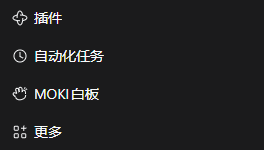

# Release validation

## 1.5.3 · Chinese sidebar label

On 2026-11-10 the running Windows DSH Desktop app and an isolated Web profile both displayed **MOKI白板** as the sidebar text and accessible name. Clicking the packaged shortcut opened the canvas beside the conversation. All seven plugin integration tests passed.

## 1.5.2 · Global sidebar navigation

Verified on 2026-11-09 with DeepSeek Harness 0.2.2-rc.1 on Windows x64. In the running Desktop app the MOKI row appeared between Automation tasks and More. All three rows measured 36 px high and their icons shared the same horizontal position. The entry also worked after collapsing and reopening the sidebar.

The public tarball was installed through the DSH CLI in an isolated Web profile. Opening the row with no active chat brought up a conversation and its canvas workspace. Repeated clicks and keyboard activation retained the existing canvas and opened one tab. Opening it from the Plugins page preserved an unsent draft. All seven plugin integration tests passed, and all 126 installed files matched the tarball.

## 1.5.1 · Initial release

Validated on 2026-11-06, on Windows x64, using the locally installed DeepSeek Harness 0.2.2-rc.1 runtime in a separate web profile. No user account, private session, or existing board database was copied into that profile.

| Check | Result |
| --- | --- |
| Self-contained canvas and host production build | Passed |
| TypeScript type check | Passed |
| Host, client and built-in guide integration tests | 5 passed |
| Canvas bridge, preview, selection isolation and mind-map tests | 22 passed |
| Install prebuilt tarball with the DSH plugin CLI | Passed |
| Actual DSH plugin discovery and renderer | Version 1.5.1 loaded |
| Built-in six-page introduction | Opens and remains editable |
| Mind-map width | Changed from 196 to 260, then 300, through the real UI |
| Selection-to-draft | Native text reference and PNG attachment added; typed prompt preserved |
| Light and dark theme synchronization | Passed; publication screenshots use dark mode |
| Page groups and materials panel | Verified in the running DSH UI |
| Portrait cover aspect ratio | 1086 × 1448, exactly 3:4 |

The collaboration captures show an unsent demonstration draft. No model response was fabricated, and no paid model call was made for the screenshots. They demonstrate canvas-to-chat attachment behavior, not model output quality.

## Public content boundary

The published repository contains the plugin source, the canvas source snapshot, build outputs, original demonstration assets, bilingual documentation, license notices and reviewed promotional media. It excludes development logs, credentials, profiles, session records, local databases, screenshots of personal work, and previous private QA reports. `.dev`, `node_modules` and build-test artifacts are ignored by Git and excluded from the npm package file list.

All eight interface screenshots were captured from the isolated demonstration profile and retain the full DSH shell, sidebar, conversation composer and canvas workspace. The selection flow is shown before and after adding it to the draft. Visible board IDs belong only to that disposable demo database. Copyright attributions and public repository author information are retained.

The original development checkout and the user's active DSH profile were not replaced by this publication workflow. The distribution package uses the public name `dsh-moki-canvas`; the old `@local/dsh-moki-whiteboard` package should be removed before installing it in the same profile.
