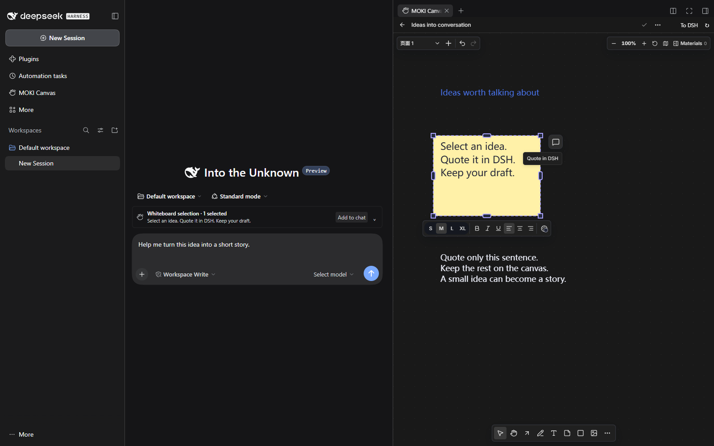
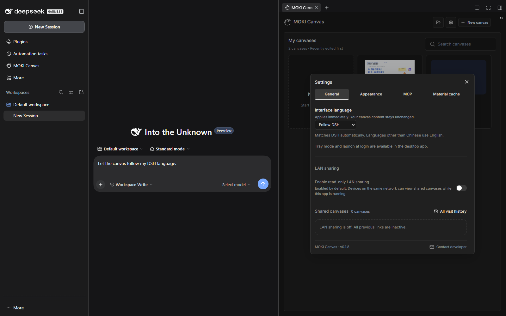
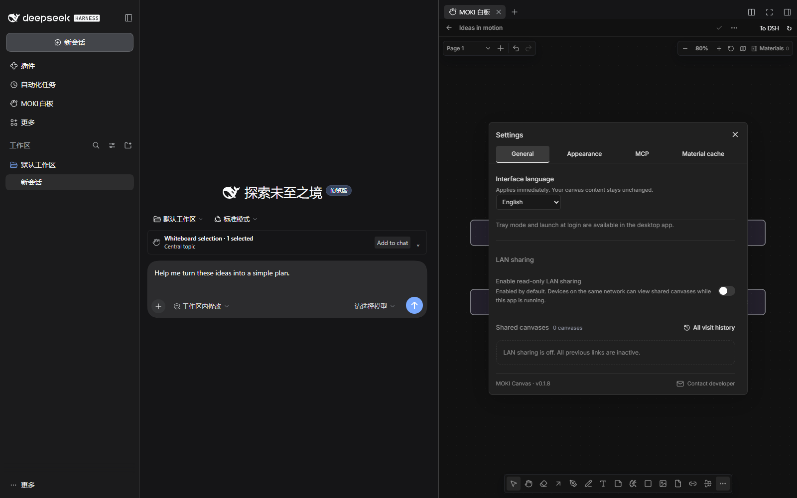

# Release validation

## 1.8.0 · Quote beside a canvas selection

Verified on 2026-11-12 with DeepSeek Harness 0.2.2-rc.1 on Windows x64, using the actual DSH conversation composer and side workspace in an isolated demo profile.

- Selecting one or multiple canvas objects reveals a compact chat icon beside the selection. Clicking it adds the native DSH quote and selection screenshot, preserves existing draft text, and focuses the composer. Clearing the selection hides the action; repeated clicks do not duplicate a quote.
- Highlighting text in the canvas text editor reveals the same action beside the highlighted line. Mouse-selected substrings, a full line, and a two-line selection were quoted exactly. Other text in the element was excluded and no missing-screenshot warning was shown for intentional text-only quotes.
- Committing the text editor before quoting preserves the captured substring. A same-object size change during commit does not invalidate the quote; selecting a different object, changing page/board, hiding the conversation, cancellation, or a busy composer cannot insert a stale result. Failed requests retain the captured excerpt for Retry.
- At 359 px workspace width and approximately 70% canvas zoom, the action stayed within the visible canvas, moved to the left of an object near the right edge, and successfully quoted text selected with the mouse. Both Chinese and English action labels are provided.
- All 50 focused canvas regression tests and 11 plugin integration tests passed. Type checking and the production build passed. No model request or automatic message submission was made.
- The local linked plugin was backed up and updated. DSH Desktop was exited normally and reopened; discovery reported 1.8.0 and the served canvas contained the new action. The user's saved Simplified Chinese preference and all six existing boards' versions and snapshot hashes were unchanged.
- The two new public captures use only a purpose-built demo board and unsent example drafts; they contain no personal account, conversation history, or local paths.

## 1.7.0 · Follow DSH language

Verified on 2026-11-12 with DeepSeek Harness 0.2.2-rc.1 on Windows x64. The release tarball was installed in a new isolated DSH Web profile.

- Fresh installation defaults to Follow DSH. Selecting Chinese, English and Japanese in DSH's own Settings immediately updated the following canvas to Chinese, English and the English fallback. The canvas iframe did not reload, and its board contents and unsent chat draft remained unchanged.
- Selecting English manually kept the canvas in English while DSH switched languages. Selecting Follow DSH again adopted the current DSH language immediately. Existing saved manual preferences remain valid.
- The stored value stays `dsh` instead of the currently resolved language. Restarting the DSH service assigned a new canvas port; the following preference survived and adopted DSH's saved Chinese language even though the browser language was English.
- All 25 focused language, startup, persistence and bridge tests, and all 9 plugin integration tests passed. These include forged-parent message rejection, no preference writes on host-language events, unchanged manual choices and restart guidance for older hosts. Type checking and the production build passed.
- At 360 px width the dark settings dialog is 344 px wide, has no horizontal overflow and retains four 34 px tabs.
- The local development plugin and actual DSH Desktop were updated and reopened normally. Discovery reported 1.7.0; Settings retained the user's current manual Simplified Chinese choice, and all six existing boards matched their pre-update versions and contents.

## 1.6.1 · Language saving after an upgrade

Verified on 2026-11-12 with DeepSeek Harness 0.2.2-rc.1 on Windows x64.

- The running Desktop instance reported host 1.5.0 while its linked UI files had been updated to 1.6.0. Its `/api/preferences` endpoint returned 404. A page refresh could load the new UI without restarting the old service.
- Missing language-save endpoints (404/405) now show a localized restart instruction and preserve the current language and draft. Transient save errors still offer Retry.
- The 1.6.1 tarball was installed in the isolated DSH Web test profile. The actual plugin discovery reported 1.6.1; switching between Chinese and English saved successfully with no error. All three demo boards were compared before and after and remained unchanged.
- The former 404 response was replayed in the browser: both language variants showed the restart instruction without the ineffective Retry control. Restoring the current endpoint allowed a successful save.
- All 9 focused language tests and 8 plugin integration tests passed, including preference persistence across a real built-host restart. Type checking and the production build passed.
- With the user's approval, the actual DSH Desktop app was exited normally from its application menu and reopened. Discovery then reported host 1.6.1 and the preference endpoint returned 200. English was saved and the reloaded desktop canvas and selection controls displayed English. All six existing boards matched their pre-restart contents and versions.

## 1.6.0 · Chinese and English interface

Verified on 2026-11-12 with DeepSeek Harness 0.2.2-rc.1 on Windows x64. The release tarball was installed through the DSH CLI in the isolated Web demo profile and opened beside a real DSH conversation.

- Settings → General → Interface language switches the canvas, open menus, dialogs and DSH selection controls immediately between Simplified Chinese and English. The page, board name, snapshot and version were compared before and after switching and remained unchanged.
- A DSH service restart assigned the canvas a different port; the saved English preference and unsent chat draft survived. A second canvas frame switched both mounted interfaces together.
- Adding the selection to the DSH draft preserved the typed prompt and added the native quote and image. No model call was made.
- New canvas pages and mind-map template labels use the selected language. Existing content and the built-in Chinese guide retain their text.
- The 360 px embedded view has a 344 px settings dialog with no horizontal overflow. Its four English tabs remain 34 px high. Page search, materials, mind-map templates, toolbar and settings categories were checked in dark mode.
- Type checking and production build passed. All 8 plugin integration tests passed; the canvas regression run passed 414 tests, followed by 29 focused tests including cross-frame language updates. The standalone macOS packaging test file was excluded because this plugin source snapshot does not ship its desktop packaging workflow; no macOS package was built or claimed.

## 1.5.3 · Chinese sidebar label

On 2026-11-10 the running Windows DSH Desktop app and an isolated Web profile both displayed **MOKI白板** as the sidebar text and accessible name. Clicking the packaged shortcut opened the canvas beside the conversation. All seven plugin integration tests passed.

## 1.5.2 · Global sidebar navigation

Verified on 2026-11-09 with DeepSeek Harness 0.2.2-rc.1 on Windows x64. In the running Desktop app the MOKI row appeared between Automation tasks and More. All three rows measured 36 px high and their icons shared the same horizontal position. The entry also worked after collapsing and reopening the sidebar.

The public tarball was installed through the DSH CLI in an isolated Web profile. Opening the row with no active chat brought up a conversation and its canvas workspace. Repeated clicks and keyboard activation retained the existing canvas and opened one tab. Opening it from the Plugins page preserved an unsent draft. All seven plugin integration tests passed, and all 126 installed files matched the tarball.

## 1.5.1 · Initial release

Validated on 2026-11-06, on Windows x64, using the locally installed DeepSeek Harness 0.2.2-rc.1 runtime in a separate web profile. No user account, private session, or existing board database was copied into that profile.

| Check | Result |
| --- | --- |
| Self-contained canvas and host production build | Passed |
| TypeScript type check | Passed |
| Host, client and built-in guide integration tests | 5 passed |
| Canvas bridge, preview, selection isolation and mind-map tests | 22 passed |
| Install prebuilt tarball with the DSH plugin CLI | Passed |
| Actual DSH plugin discovery and renderer | Version 1.5.1 loaded |
| Built-in six-page introduction | Opens and remains editable |
| Mind-map width | Changed from 196 to 260, then 300, through the real UI |
| Selection-to-draft | Native text reference and PNG attachment added; typed prompt preserved |
| Light and dark theme synchronization | Passed; publication screenshots use dark mode |
| Page groups and materials panel | Verified in the running DSH UI |
| Portrait cover aspect ratio | 1086 × 1448, exactly 3:4 |

The collaboration captures show an unsent demonstration draft. No model response was fabricated, and no paid model call was made for the screenshots. They demonstrate canvas-to-chat attachment behavior, not model output quality.

## Public content boundary

The published repository contains the plugin source, the canvas source snapshot, build outputs, original demonstration assets, bilingual documentation, license notices and reviewed promotional media. It excludes development logs, credentials, profiles, session records, local databases, screenshots of personal work, and previous private QA reports. `.dev`, `node_modules` and build-test artifacts are ignored by Git and excluded from the npm package file list.

All eight interface screenshots were captured from the isolated demonstration profile and retain the full DSH shell, sidebar, conversation composer and canvas workspace. The selection flow is shown before and after adding it to the draft. Visible board IDs belong only to that disposable demo database. Copyright attributions and public repository author information are retained.

The original development checkout and the user's active DSH profile were not replaced by this publication workflow. The distribution package uses the public name `dsh-moki-canvas`; the old `@local/dsh-moki-whiteboard` package should be removed before installing it in the same profile.
